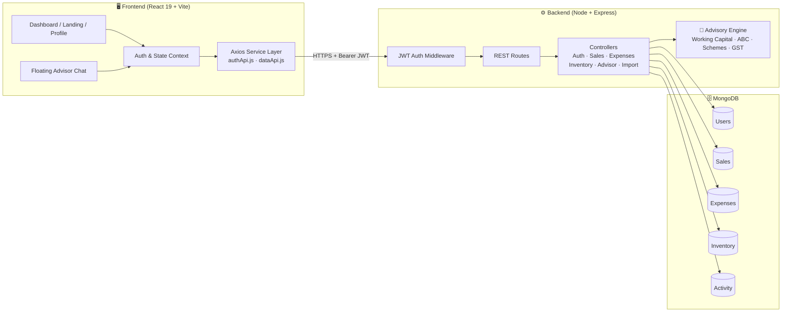

<div align="center">

# 📈 MSME Growth Advisor

### An intelligent financial, operational, inventory & strategic growth platform built for Indian MSMEs

*Track revenue. Audit expenses. Forecast demand. Prevent stockouts. Unlock government schemes.*

<br />


[🌐 Live Demo](https://msme-growth-advisor-1.onrender.com/) • [Features](#-key-features) • [Architecture](#-architecture-overview) • [Getting Started](#-getting-started) • [API Reference](#-api-reference) • [Contributing](#-contributing)

</div>

---

## 📑 Table of Contents

- [About the Project](#-about-the-project)
- [Key Features](#-key-features)
- [Screenshots & Demo](#-screenshots--demo)
- [Tech Stack](#-tech-stack)
- [Architecture Overview](#-architecture-overview)
- [Project Structure](#-project-structure)
- [Getting Started](#-getting-started)
- [Environment Variables](#-environment-variables)
- [API Reference](#-api-reference)
- [Advisory Engine](#-advisory-engine)
- [Security](#-security)
- [Roadmap](#-roadmap)
- [Contributing](#-contributing)
- [License](#-license)

---

## 🎯 About the Project

India's **63+ million MSMEs** contribute nearly 30% of the country's GDP, yet most still run on scattered Excel sheets, paper ledgers, and gut instinct. The result: surprise stockouts, delayed receivables, hidden cost leakage, and missed access to subsidised credit.

**MSME Growth Advisor** puts a CFO, an inventory planner, and a scheme consultant in one dashboard. It enables business owners to:

- 💰 Track **recognized revenue** and monitor **cash collection**
- 🧾 **Audit operating expenses** with clean separation from raw material procurement
- 📦 **Forecast inventory demand** and **prevent stockouts**
- 🧠 Receive **context-aware strategic advice** grounded in Indian financial norms and government schemes: **MUDRA, CGTMSE, PMEGP, and TReDS**

---

## ✨ Key Features

| Feature | Description |
|---|---|
| 📊 **P&L & Accounting Audit** | Accurate revenue recognition, receivable tracking, and expense ledger auditing, isolating raw material procurement inventory from operating overhead for a true profit picture. |
| 📦 **Real-Time Inventory & Demand Forecasting** | Automated reorder point alerts, stockout forecasting, **ABC inventory classification**, and fast-moving SKU identification. |
| 🤖 **AI Growth Advisor Chatbot** | Floating, always-available assistant offering recommendations on credit lines, **invoice discounting (TReDS)**, cost optimization, and government schemes. |
| 📥 **Bulk Excel/CSV Importer** | Smart column auto-detection and data sanitization to onboard legacy ledgers in minutes. |
| 📤 **One-Click Export** | Export financial statements, ledger entries, and performance reports to **CSV / Excel**. |
| 🔐 **Role-Based Auth & Multi-Tenancy** | Isolated per-business data secured with **JWT** tokens and **salted bcrypt** password hashing. |

---

## 🖼️ Screenshots & Demo

🌐 **Live Demo:** [msme-growth-advisor-1.onrender.com](https://msme-growth-advisor-1.onrender.com/)

> ⏳ Hosted on Render's free tier, so the first load may take up to a minute.

| Dashboard | Inventory & Forecasting |
|:---:|:---:|
|  |  |

---

## 🛠️ Tech Stack

### Frontend
- **React 19** with **Vite** for fast builds and HMR
- **Tailwind CSS v4** for utility-first styling
- **Lucide React** for modern icons
- **React Router v7** for client-side routing
- **Axios** API client with request/response interceptors
- **SheetJS (`xlsx`)** for Excel/CSV parsing and export

### Backend
- **Node.js & Express** (ES Modules)
- **MongoDB & Mongoose** (Atlas or local)
- **JWT** & **bcryptjs** for secure authentication
- **CORS** & **Dotenv** for configuration

### Data & Intelligence
- Context-aware **Indian MSME advisory engine** covering Working Capital, ABC Inventory Analysis, Government Subsidies, and GST Compliance
- **Predictive demand growth** metrics and **stockout prevention**

---

## 🏗️ Architecture Overview



**Request flow:** the client attaches a JWT through an Axios interceptor → Express middleware verifies the token and scopes every query to the authenticated business → controllers read or write MongoDB → the advisory engine turns the numbers into actionable, India-specific recommendations.

---

## 📂 Project Structure

```
MSME-Growth-Advisor/
├── MSME/                      # Frontend React + Vite application
│   └── src/
│       ├── components/        # Dashboard, FloatingAdvisorChat, Profile, Landing, Modals
│       ├── context/           # Auth & State contexts
│       ├── services/          # Axios API layer (dataApi.js, authApi.js)
│       └── utils/             # Formatting & calculation utilities
│
└── backend/                   # Express REST API
    ├── config/                # Database connection (db.js)
    ├── controllers/           # Auth, Sales, Expenses, Inventory, Advisor, Import
    ├── middleware/            # JWT auth middleware
    ├── models/                # User, Sale, Expense, Inventory, Activity
    ├── routes/                # REST endpoints (/api/auth, /api/sales, ...)
    └── server.js              # Server entry point
```

---

## 🚀 Getting Started

### Prerequisites

- **Node.js** v18 or higher
- **npm** v9+ (or yarn / pnpm)
- A **MongoDB** instance: [MongoDB Atlas](https://www.mongodb.com/atlas) (free tier works) or local MongoDB
- **Git**

### 1️⃣ Clone the Repository

```bash
git clone https://github.com/<your-username>/MSME-Growth-Advisor.git
cd MSME-Growth-Advisor
```

### 2️⃣ Set Up the Backend

```bash
cd backend
npm install
```

Create a `.env` file inside `backend/` (see [Environment Variables](#-environment-variables)), then start the server:

```bash
npm run dev
```

✅ API is now running at **http://localhost:5000**

### 3️⃣ Set Up the Frontend

Open a **new terminal**:

```bash
cd MSME
npm install
npm run dev
```

✅ App is now running at **http://localhost:5173**

### 4️⃣ Create Your Account

Open the app, click **Get Started**, register your business, and import your first ledger or add a sale manually.

---

## 🔑 Environment Variables

Create `backend/.env`:

```env
# Server
PORT=5000

# Database
MONGO_URI=mongodb+srv://<username>:<password>@<cluster>.mongodb.net/msme-growth-advisor

# Auth
JWT_SECRET=your_jwt_secret_key

# CORS
CLIENT_URL=http://localhost:5173
```

| Variable | Required | Description |
|---|:---:|---|
| `PORT` | ✅ | Port the Express server listens on (default `5000`) |
| `MONGO_URI` | ✅ | MongoDB connection string (Atlas or local) |
| `JWT_SECRET` | ✅ | Secret used to sign JWTs. Use a long, random string in production |
| `CLIENT_URL` | ✅ | Allowed frontend origin for CORS |

> ⚠️ **Never commit your `.env` file.** Make sure it is listed in `.gitignore`.

---

## 📡 API Reference

**Base URL:** `http://localhost:5000/api`
All routes except `/auth/register` and `/auth/login` require the header:

```
Authorization: Bearer <your_jwt_token>
```

### 🔐 Authentication: `/api/auth`

| Method | Endpoint | Description | Auth |
|:---:|---|---|:---:|
| `POST` | `/auth/register` | Register a new business account | ❌ |
| `POST` | `/auth/login` | Log in and receive a JWT | ❌ |
| `GET` | `/auth/me` | Get current user / business profile | ✅ |
| `PUT` | `/auth/profile` | Update business profile | ✅ |

### 💰 Sales: `/api/sales`

| Method | Endpoint | Description | Auth |
|:---:|---|---|:---:|
| `GET` | `/sales` | List sales with filters and pagination | ✅ |
| `POST` | `/sales` | Record a new sale / invoice | ✅ |
| `PUT` | `/sales/:id` | Update a sale (e.g. mark payment received) | ✅ |
| `DELETE` | `/sales/:id` | Delete a sale | ✅ |

### 🧾 Expenses: `/api/expenses`

| Method | Endpoint | Description | Auth |
|:---:|---|---|:---:|
| `GET` | `/expenses` | List expenses (operating vs. procurement) | ✅ |
| `POST` | `/expenses` | Add an expense entry | ✅ |
| `PUT` | `/expenses/:id` | Update an expense | ✅ |
| `DELETE` | `/expenses/:id` | Delete an expense | ✅ |

### 📦 Inventory: `/api/inventory`

| Method | Endpoint | Description | Auth |
|:---:|---|---|:---:|
| `GET` | `/inventory` | List all SKUs with stock levels | ✅ |
| `POST` | `/inventory` | Add a new SKU | ✅ |
| `PUT` | `/inventory/:id` | Update stock, pricing, or reorder point | ✅ |
| `DELETE` | `/inventory/:id` | Remove a SKU | ✅ |
| `GET` | `/inventory/forecast` | Demand forecast, stockout risk, ABC classification | ✅ |

### 🤖 Advisor: `/api/advisor`

| Method | Endpoint | Description | Auth |
|:---:|---|---|:---:|
| `POST` | `/advisor/chat` | Send a query to the Growth Advisor chatbot | ✅ |
| `GET` | `/advisor/insights` | Get proactive, data-driven recommendations | ✅ |

### 📥 Import: `/api/import`

| Method | Endpoint | Description | Auth |
|:---:|---|---|:---:|
| `POST` | `/import/sales` | Bulk import sales from parsed CSV/Excel | ✅ |
| `POST` | `/import/expenses` | Bulk import expenses | ✅ |
| `POST` | `/import/inventory` | Bulk import inventory SKUs | ✅ |

### 🕒 Activity: `/api/activity`

| Method | Endpoint | Description | Auth |
|:---:|---|---|:---:|
| `GET` | `/activity` | Recent activity / audit trail for the business | ✅ |

<details>
<summary><b>📘 Example: Login request & response</b></summary>

```http
POST /api/auth/login
Content-Type: application/json

{
  "email": "owner@sharmatextiles.in",
  "password": "securePassword123"
}
```

```json
{
  "success": true,
  "token": "eyJhbGciOiJIUzI1NiIsInR5cCI6IkpXVCJ9...",
  "user": {
    "id": "665f1c...",
    "businessName": "Sharma Textiles",
    "email": "owner@sharmatextiles.in"
  }
}
```
</details>

---

## 🧠 Advisory Engine

The advisor is **context-aware**: it reads your actual sales, expenses, and inventory before answering.

| Domain | What it does |
|---|---|
| **Working Capital** | Flags cash-conversion gaps, overdue receivables, and recommends credit lines or overdraft limits |
| **Invoice Discounting** | Suggests **TReDS** (RXIL, M1xchange, Invoicemart) for stuck receivables |
| **ABC Inventory Analysis** | Classifies SKUs by value contribution (A = high, B = medium, C = low) to focus capital |
| **Stockout Prevention** | Predicts days-of-cover from demand trends and triggers reorder alerts |
| **Government Schemes** | Matches your profile to **MUDRA**, **CGTMSE**, **PMEGP**, and more |
| **GST Compliance** | Surfaces filing reminders and input-tax-credit optimization tips |

---

## 🔒 Security

- 🔐 Passwords hashed and salted with **bcryptjs**
- 🎟️ Stateless authentication via **JWT**
- 🧱 **Multi-tenant isolation**: every query is scoped to the authenticated user
- 🌐 **CORS** restricted to the configured `CLIENT_URL`
- 🙈 Secrets managed through environment variables

Found a vulnerability? Please report it privately through GitHub's **Security → Report a vulnerability** option instead of opening a public issue.

---

## 🗺️ Roadmap

- [x] P&L, receivables, and expense auditing
- [x] Inventory forecasting with ABC classification
- [x] AI Growth Advisor chatbot
- [x] Bulk Excel/CSV import and export
- [ ] GST invoice generation & GSTR-ready reports
- [ ] WhatsApp payment reminders for overdue invoices
- [ ] Multi-user roles per business (Owner / Accountant / Staff)
- [ ] Hindi & regional language support
- [ ] Mobile app (React Native)
- [ ] Tally / Zoho Books integration

---

## 🤝 Contributing

Contributions make the open-source community great. **Any contribution is appreciated!**

1. **Fork** the repository
2. **Create** your feature branch
   ```bash
   git checkout -b feature/amazing-feature
   ```
3. **Commit** your changes
   ```bash
   git commit -m "feat: add amazing feature"
   ```
4. **Push** to your branch
   ```bash
   git push origin feature/amazing-feature
   ```
5. **Open a Pull Request**

### Guidelines

- Follow [Conventional Commits](https://www.conventionalcommits.org/) for commit messages
- Keep PRs focused and well described
- Test your changes locally (frontend and backend) before submitting
- Open an issue first for major changes

---

## 📄 License

Distributed under the **MIT License**. See [`LICENSE`](LICENSE) for more information.

---

<div align="center">

**Project Link:** [github.com/your-username/MSME-Growth-Advisor](https://github.com/your-username/MSME-Growth-Advisor)

### ⭐ If this project helps you, please give it a star!

*Built with ❤️ to empower India's MSMEs*

</div>
